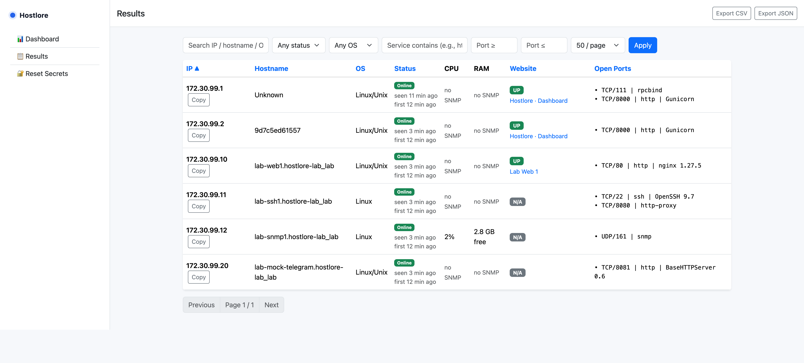
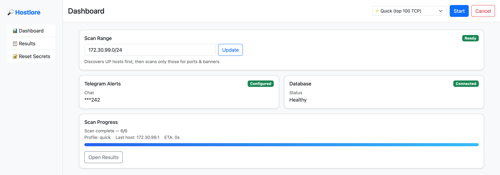
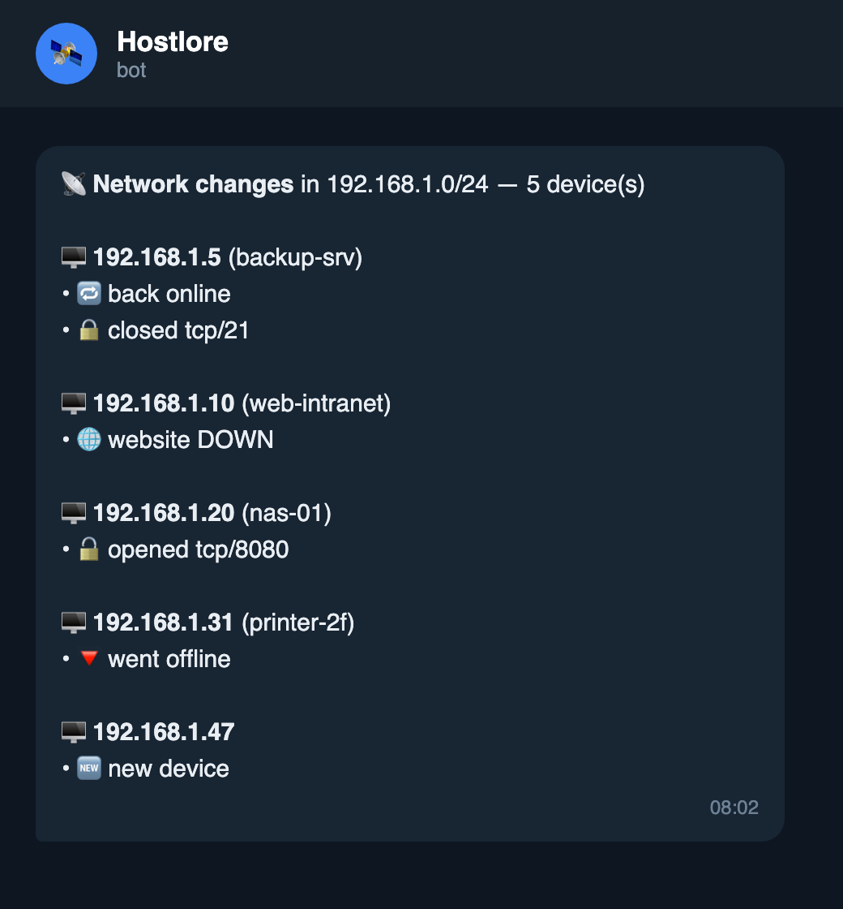
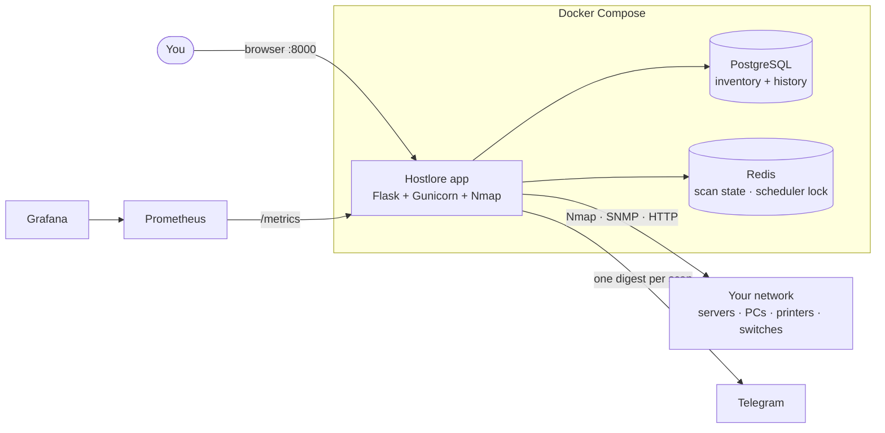
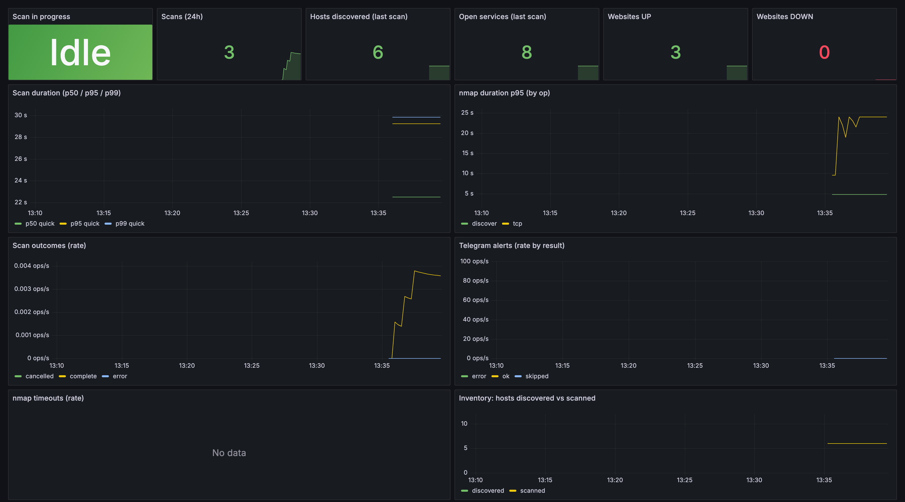
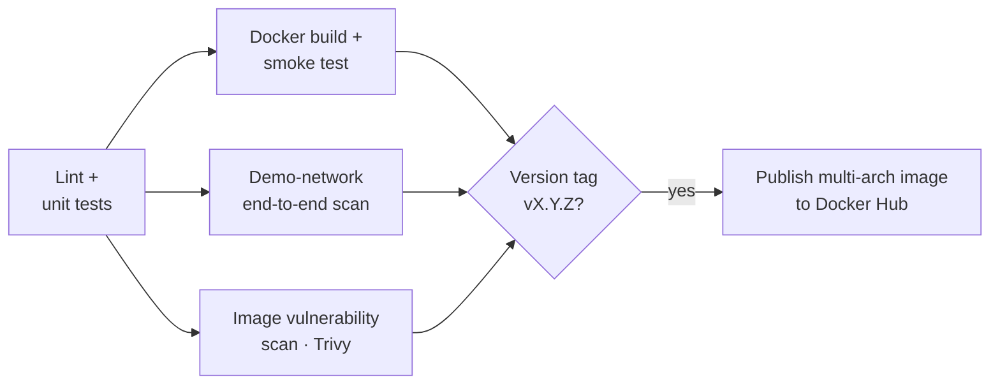

<div align="center">

# 🛰️ Hostlore

### The story of every host on your network.

Hostlore finds every device on your network, remembers it, and tells you **the moment something changes**:
a new device, a server going offline, a new open port, a website going down.
No agents, nothing to install on your machines.

[](https://github.com/ringsfrings/hostlore/actions/workflows/ci.yml)
[](https://hub.docker.com/r/ringsfrings/hostlore)

[](LICENSE)

[Quick start](#-quick-start) · [Features](#-features) · [How it works](#-how-it-works) · [Monitoring](#-monitoring-with-prometheus--grafana) · [Demo network](#-try-it-on-a-demo-network) · [Configuration](#%EF%B8%8F-configuration)



</div>

---

## Why Hostlore

Most network problems don't start with an outage. They start with a **small change nobody noticed**: an unknown laptop on the office Wi-Fi, a service nobody approved, a backup server that went quiet three days ago.

A one-off scan shows you the network *once*. Hostlore keeps scanning, keeps the **history of every host**, and sends you **one short message with only what changed**, so you hear about the important things and nothing else.

<table>
<tr>
<td width="55%"></td>
<td width="45%"></td>
</tr>
<tr>
<td align="center"><sub>Dashboard: scan range, alert and database status, live scan progress</sub></td>
<td align="center"><sub>One Telegram digest per scan: only what changed</sub></td>
</tr>
</table>

## ✨ Features

| | |
|---|---|
| 🔍 **Agentless discovery** | Finds devices, open ports, services, websites and their titles, using Nmap, SNMP, NetBIOS and HTTP. Nothing to install on targets. |
| 🔔 **Change alerts** | 🆕 new device · 🔻 went offline · 🔁 back online · 🔓 port opened · 🔒 port closed · 🌐 website up/down · 🏷️ title changed |
| 🤫 **No noise** | The first scan is a silent baseline; after that, one Telegram digest per scan, only when something changed. Slow hosts are never reported as "all ports closed". |
| 🕒 **Device history** | Online / offline status, first seen and last seen for every host. |
| 🧠 **OS detection** | From service banners, SNMP, SMB and, as a last resort, the TTL of reply packets (Linux/Unix · Windows · network device). |
| 📊 **Dashboard & exports** | Live scan progress, filters (status, OS, service, port range), CSV and JSON export. |
| 📈 **Observability built in** | Prometheus metrics and a ready-made Grafana dashboard. |
| 🛡️ **Secure by default** | Encrypted settings, database password as a Docker secret, optional login, rate-limited sensitive pages, image scanned for vulnerabilities on every build. |
| ⏱️ **Scheduled scans** | Scan every 15 min, every hour… exactly one scheduler runs even with several web workers. |
| 🐳 **One-command deploy** | Docker Compose, multi-arch images (amd64 / arm64): runs on a server, a NAS or a Raspberry Pi. |

## 🚀 Quick start

You need Docker with the Compose plugin.

```bash
git clone https://github.com/ringsfrings/hostlore.git && cd hostlore

# 1. Settings and database password (both stay on your machine, never in git)
cp .env.example .env
sed -i.bak "s/^FLASK_SECRET_KEY=.*/FLASK_SECRET_KEY=$(openssl rand -hex 32)/" .env && rm .env.bak
mkdir -p secrets && openssl rand -hex 24 > secrets/db_password.txt && chmod 600 secrets/db_password.txt

# 2. Start, using the published image from Docker Hub
docker compose pull && docker compose up -d
```

Open **http://localhost:8000** and fill in the setup page:
- **IP range** to watch, e.g. `192.168.1.0/24`
- **Telegram bot token and chat ID** (optional; create a bot with [@BotFather](https://t.me/BotFather))

Then press **Start**. Settings can be changed later under *Reset Secrets*.

<details>
<summary><b>Build from source instead</b></summary>

```bash
docker compose up -d --build
```
</details>

<details>
<summary><b>Pin a version</b></summary>

```bash
HOSTLORE_TAG=1.0.0 docker compose pull && HOSTLORE_TAG=1.0.0 docker compose up -d
```
Image tags: `X.Y.Z`, `X.Y` and `latest` (= newest release). See [Releases](https://github.com/ringsfrings/hostlore/releases).
</details>

## 🧩 How it works



1. **Discover**: find which hosts are up in the range.
2. **Scan**: ports, service versions, websites, SNMP, OS family for each host.
3. **Compare**: diff against the stored state of every host.
4. **Notify**: send one digest with the changes (or a one-time baseline summary on the first scan).

## 📈 Monitoring with Prometheus + Grafana

```bash
docker compose -f docker-compose.yml -f docker-compose.observability.yml up -d
```

- **Grafana**: http://localhost:3000 (admin user from `GF_ADMIN_*` in `.env`); the *Hostlore* dashboard is provisioned automatically
- **Prometheus**: http://localhost:9090



<details>
<summary><b>Metrics reference</b></summary>

| Metric | Type | Meaning |
|---|---|---|
| `hostlore_scans_total{profile,result}` | counter | Finished scans by outcome |
| `hostlore_scan_duration_seconds{profile}` | histogram | Full scan duration |
| `hostlore_scan_in_progress` | gauge | 1 while a scan runs |
| `hostlore_hosts_discovered` / `hostlore_hosts_scanned` | gauge | Hosts in the last scan |
| `hostlore_services_open` | gauge | Open services |
| `hostlore_websites_up` / `hostlore_websites_down` | gauge | Website status |
| `hostlore_nmap_duration_seconds{op}` | histogram | Time per Nmap step |
| `hostlore_nmap_timeouts_total{op}` | counter | Nmap timeouts |
| `hostlore_telegram_sends_total{result}` | counter | Alert deliveries |

Metrics are aggregated across all web workers.
</details>

## 🧪 Try it on a demo network

No spare network? Hostlore ships with a small **simulated office network** in Docker (a web server, an SSH server, an SNMP device and a fake Telegram) and a script that shows every feature in about 2 minutes:

```bash
./lab/e2e.sh            # add KEEP=0 to remove the demo network afterwards
```

It sets Hostlore up, records a baseline, then **changes the network** and checks that each change is reported:

| Step | What happens on the network | What Hostlore reports |
|---|---|---|
| 1 | First scan | One baseline message; every device, port, website and SNMP value recorded |
| 2 | Nothing changes | Nothing (no noise) |
| 3 | A new service starts on port 8080 | 🔓 opened tcp/8080 |
| 4 | The web server is switched off | 🔻 went offline, shown as *Offline* in the dashboard |
| 5 | The web server comes back | 🔁 back online |

The demo uses its own settings volume and never touches your real configuration. On Docker Desktop, the demo web server is also reachable at http://localhost:8088.

## ⚙️ Configuration

All settings live in `.env` (copy `.env.example`):

| Variable | Default | Purpose |
|---|---|---|
| `FLASK_SECRET_KEY` | **required** | Session and CSRF key (`openssl rand -hex 32`) |
| `POSTGRES_USER` / `POSTGRES_DB` | `netadmin` / `network_inventory` | Database created on first start |
| `HOSTLORE_TAG` | `latest` | Image version to run |
| `HOSTLORE_AUTH_USER` / `HOSTLORE_AUTH_PASSWORD_HASH` | empty (login off) | Turn on login. Hash: `python -c 'import bcrypt; print(bcrypt.hashpw(b"pass", bcrypt.gensalt()).decode())'` |
| `SCAN_SCHEDULE_INTERVAL` | empty (off) | Automatic scans, e.g. `15m`, `1h` |
| `GUNICORN_WORKERS` | `3` | Web workers |
| `GF_ADMIN_USER` / `GF_ADMIN_PASSWORD` | `admin` / `admin` | Grafana admin (monitoring add-on) |

**Scan profiles** (chosen on the dashboard):

| Profile | Covers | Best for |
|---|---|---|
| ⚡ Quick | Top 100 TCP ports | Frequent scheduled scans |
| 🧭 Balanced | Top 2000 TCP ports + OS fingerprint | Daily inventory |
| 🌊 Deep | All TCP ports + top 200 UDP + OS fingerprint | Audits |

**CPU and RAM** are read over SNMP, the standard monitoring protocol of servers, switches, routers and printers. Devices without SNMP enabled show *no SNMP*; Hostlore never logs into your machines.

## 🔄 CI/CD

Every push and pull request runs the full pipeline. A release is published only when a version tag passes every check:



## 🔒 Security

- Turn on login (`HOSTLORE_AUTH_*`) or put Hostlore behind a reverse proxy with TLS before exposing it beyond your LAN.
- `.env`, `secrets/` and `config/secrets.enc` stay on your machine and are git-ignored.
- **Only scan networks you own or are authorised to scan.**

## 🗺️ Roadmap

- [ ] Custom SNMP community and SNMPv3 credentials in the settings page
- [ ] Slack, Discord and email notifications
- [ ] Device notes and tags (owner, location)
- [ ] Helm chart for Kubernetes

Ideas and bug reports are welcome in [Issues](https://github.com/ringsfrings/hostlore/issues).

## 🤝 Contributing

```bash
python3.10 -m venv .venv && . .venv/bin/activate
pip install -r requirements-dev.txt
ruff check . && pytest
./lab/e2e.sh
```

Open a pull request; the pipeline runs every check automatically.

## 📄 License

[MIT](LICENSE) © Mohamed Bilal Toaba

---

<div align="center">
Built by <a href="https://github.com/ringsfrings">Mohamed Bilal Toaba</a>, DevOps Engineer.<br/>
Need monitoring, CI/CD or a secure Docker setup for your team? <a href="https://github.com/ringsfrings">Get in touch</a>.
</div>
